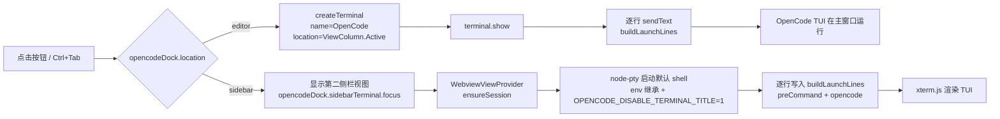

# OpenCode Dock

在 VS Code 中一键启动 [OpenCode](https://opencode.ai) TUI：默认以标签页停靠在**编辑器区域**，也可切到**第二侧栏的内嵌终端**。点击状态栏按钮或按快捷键（默认 `Ctrl+Tab`）即启动，并可在启动前自动执行自定义命令（切换目录、注入环境变量等）。

在 VS Code 里使用 OpenCode TUI 的常规体验是：手动新建终端 → 键入 `opencode` → 终端落在底部面板，与代码编辑区割裂；若项目还需要 `cd`、`export`、`source` 等前置准备，则每次都要重复一遍。OpenCode Dock 把这条路径收敛为**一次点击**：终端以标签页打开在编辑器区域（与代码同屏），或常驻第二侧栏（右侧，与代码互不遮挡），沿用 VS Code 默认终端配置（无需另配 shell），标签固定为 `OpenCode`。

v0.1.0 · VS Code ^1.106.0 · TypeScript

[TOC]

## 功能特性

- **一键启动**：状态栏右侧 `$(rocket) OpenCode` 按钮，或默认快捷键 `Ctrl+Tab`。
- **两种打开位置**：`opencodeDock.location` 设为 `editor`（默认）时以编辑器标签页打开；设为 `sidebar` 时在**第二侧栏**内嵌终端打开（真正的 PTY + xterm.js 渲染，非复制粘贴式伪终端）。直接点击第二侧栏的 OpenCode 视图也会自动启动。
- **图标统一**：状态栏按钮、终端标签页、侧栏视图均使用内置 codicon `rocket`（无需打包图片资源）。
- **编辑器区域标签页**：终端以标签页打开在主窗口，与代码同屏，而非侧边/底部终端面板。
- **第二侧栏内嵌终端**：由扩展贡献到第二侧栏（VS Code 1.106+ 的 `viewsContainers.secondarySidebar`），基于 node-pty + xterm.js 的真实 shell，支持缩放、滚动、复制粘贴与进程退出后按 Enter 重开。
- **前置环境可准备**：`opencodeDock.preCommand` 多行命令在启动 OpenCode 前逐条执行，适合 `cd`、`export`、`source` 等场景。
- **与手动开终端一致**：编辑器标签页不指定 `shellPath`，沿用 VS Code 默认终端 profile 与继承环境；侧栏内嵌终端使用 `vscode.env.shell`（同样受 `terminal.integrated.defaultProfile` 影响）并从扩展宿主环境继承变量。
- **标题稳定**：两种方式都注入 `OPENCODE_DISABLE_TERMINAL_TITLE=1`，阻止 OpenCode TUI 改写终端标题，标签始终显示 `OpenCode`。
- **逻辑可测**：启动命令的组装、PTY 会话封装、Webview HTML 模板均为独立模块（纯函数/可注入），可单元测试。

## 快速开始

### 前提

- VS Code `^1.106.0`（第二侧栏视图贡献点自 1.106 起支持）
- 已安装 [OpenCode CLI](https://opencode.ai/docs/)（默认命令为 `opencode`，也可配置为 `bunx opencode`、`npx @sst/opencode` 等）

### 从源码安装

```powershell
npm install
npm run compile
npm test
npm run package
code --install-extension .\release\opencode-dock-win32-x64-0.1.0.vsix
```

也可以在 VS Code 扩展面板选择“从 VSIX 安装…”选中产物 `release\opencode-dock-<platform>-0.1.0.vsix`。

### 使用

- 点击状态栏右侧的 `$(rocket) OpenCode` 按钮，或按 `Ctrl+Tab`，即在 `opencodeDock.location` 指定的位置打开名为 `OpenCode` 的终端并启动 OpenCode TUI。
- 也可以直接点击第二侧栏的 OpenCode 视图（活动栏右侧 rocket 图标）——打开视图即自动启动。

### 配置

| 设置 | 类型 | 默认值 | 说明 |
| --- | --- | --- | --- |
| `opencodeDock.command` | string | `opencode` | 启动 OpenCode 的命令，例如 `opencode`、`bunx opencode`、`npx @sst/opencode` 或可执行文件绝对路径 |
| `opencodeDock.preCommand` | string | `""` | 启动 OpenCode 前依次执行的命令，每行一条，空行忽略（设置中以多行文本编辑） |
| `opencodeDock.location` | enum | `editor` | 打开位置：`editor`（编辑器区域标签页，默认）或 `sidebar`（第二侧栏内嵌终端） |

示例：

```json
{
  "opencodeDock.command": "opencode",
  "opencodeDock.preCommand": "cd D:/work/my-project\nexport OPENCODE_MODEL=anthropic/claude-sonnet-4-5\nsource ./.env",
  "opencodeDock.location": "sidebar"
}
```

### 快捷键

- 默认 `Ctrl+Tab`，与点击按钮等效（触发同一命令 `opencodeDock.launch`）。
- 改绑/删除：`Ctrl+K Ctrl+S` 搜索 “OpenCode Dock” 或命令 `opencodeDock.launch`，也可直接编辑 `keybindings.json`。
- 注意：扩展贡献的键位优先于 VS Code 内置键位，`Ctrl+Tab` 默认会覆盖内置的“最近使用的编辑器”切换；需要恢复时按上述方式删除键位即可。VS Code 扩展 API 不支持运行时注册快捷键，因此键位无法做成设置项。

## 原理

点击按钮或按快捷键后，扩展触发 `opencodeDock.launch` 命令，按 `opencodeDock.location` 走两条路径：



- **编辑器标签页路径**：`createTerminal` 的 `location` 使用 `ViewColumn.Active`，使终端以标签页出现在编辑器区域；不设置该字段时 VS Code 默认放在底部终端面板。
- **第二侧栏路径**（`src/sidebar/`）：扩展通过 `viewsContainers.secondarySidebar` 把 Webview 视图贡献到第二侧栏（VS Code 1.106+）；`SidebarTerminalProvider` 用 `node-pty` 启动默认 shell（`vscode.env.shell`、工作区根目录、继承环境），把 preCommand 与启动命令逐行写入 PTY，前端用 `xterm.js` 渲染并通过消息协议（`messages.ts`）双向传输输入/输出/尺寸/重开事件。
- **复用默认终端环境**：编辑器标签页不传 `shellPath`/`cwd`，与用户手动点击“+”新建终端行为一致。
- **固定标签名**：OpenCode TUI 会通过 OSC 序列改写终端标题，扩展在 `env` 中注入 `OPENCODE_DISABLE_TERMINAL_TITLE=1` 禁用之，保证标签恒为 `OpenCode`（侧栏视图无标题 UI，注入同样使其不向 xterm 发送标题序列）。
- **命令组装**：`buildLaunchLines`（`src/launchPlan.ts`）是纯函数：`preCommand` 按行拆分、清理首尾空白、忽略空行，最后追加启动命令。与 VS Code API 解耦，因此可在无 GUI 环境下单元测试。
- **每次新建**：每次触发都新建终端、不复用旧终端，行为可预期（侧栏方式下若会话仍在运行则复用并聚焦）。

## 注意事项

- 扩展每次触发都会新建终端，不会复用或自动关闭旧终端；不需要时请手动关闭（侧栏方式下会话存活于视图，关闭视图即退出）。
- `Ctrl+Tab` 是扩展贡献的默认键位，会覆盖 VS Code 内置的“最近使用的编辑器”切换，改绑方法见上节。
- 无法在窗口**标题栏**添加按钮：VS Code 官方扩展 API 不支持（Copilot 的标题栏按钮是 VS Code 核心硬编码），也没有“点击活动栏图标即执行命令”的扩展点；本扩展采用官方支持的状态栏右侧位置，如需顶部按钮可改用 `editor/title` 菜单贡献（见 `package.json` 的 `contributes.menus`）。
- **侧栏内嵌终端是“真正的 PTY”**：由本扩展携带的 `node-pty` 原生模块提供。因此 vsix 包含平台相关的二进制（win32/darwin 使用 npm 包自带的预编译，linux 需在对应平台构建），请安装与你的平台匹配的产物（文件名含 `win32-x64` 等后缀）。
- **原生终端无法放入第二侧栏**：VS Code 扩展 API 的 `createTerminal` 位置至今只有 `Panel`/`Editor` 两种；侧栏终端必须使用 Webview + node-pty 方案实现。
- `preCommand` 由默认 shell 逐条执行，属于真实 shell 命令（PowerShell、bash 等）；建议先 `cd` 到目标目录或使用绝对路径。
- `OPENCODE_DISABLE_TERMINAL_TITLE` 由 OpenCode 识别，仅对本扩展创建的终端生效。
- 图标使用 VS Code 内置 codicon：状态栏按钮用 `$(rocket)`，终端标签页用 `new ThemeIcon('rocket')`，侧栏视图用 `$(rocket)`，无需打包图片资源。终端标签的 `ThemeIcon` 需要 VS Code 1.96+；`viewsContainers.secondarySidebar` 需要 1.106+，故引擎要求为 `^1.106.0`。

## 开发说明

- 技术栈：TypeScript + VS Code Extension API；webview 侧用 esbuild 打包 `@xterm/xterm`；PTY 由 `node-pty` 提供；测试用 Node 内置 test runner。
- 目录结构：

```
src/extension.ts                     # 激活：注册命令、状态栏按钮、侧栏视图与终端
src/launchPlan.ts                    # 启动命令组装（纯函数）
src/sidebar/terminalViewProvider.ts  # 第二侧栏 Webview 视图（消息协议、会话管理）
src/sidebar/ptySession.ts            # node-pty 会话封装（可注入 spawn，便于测试）
src/sidebar/webviewHtml.ts           # Webview HTML 模板（纯函数）
src/sidebar/messages.ts              # webview 与宿主的消息类型（单一来源）
src/webview/terminalMain.ts          # xterm.js 前端入口（esbuild → media/terminal.js）
test/                                # 单元测试（launchPlan / ptySession / webviewHtml）
scripts/build-webview.mjs            # esbuild 打包 webview 资源
scripts/package.mjs                  # vsce 打包（current / all / 指定 target）
media/                               # webview 构建产物（编译生成）
out/                                 # tsc 编译输出（构建生成）
release/                             # 打包产物 vsix（构建生成）
```

- 构建：`npm run compile`（tsc 输出到 `out/`、webview 类型检查并打包 `media/`）。webview 代码改动后需重新 `npm run compile`（或 `node scripts/build-webview.mjs`）。
- 调试：打开项目目录后按 `F5` 启动 Extension Development Host（见 `.vscode/launch.json`）。
- 测试：`npm test`（`pretest` 自动编译），覆盖 `buildLaunchLines`、`PtySession`（注入 mock 的 spawn 工厂）与 Webview HTML（CSP/nonce），无需真实 VS Code 环境。
- 打包：`npm run package` 打包当前平台；`npm run package:all` 遍历全部支持平台（win32/darwin/linux × x64/arm64）。linux 平台无预编译二进制，需在 linux 上安装依赖后打包，或使用 `.github/workflows/release.yml` 的矩阵构建。
- 环境提示：本项目使用 `npm install-scripts` 白名单策略；`esbuild` 的 postinstall 需 `npm install-scripts approve esbuild` 后可用（见下方命令）。
- 贡献：保持 `buildLaunchLines` 为无副作用的纯函数；`PtySession` 通过注入 spawn 工厂解耦 `node-pty`；新增逻辑应补充对应单元测试。

## 作者信息

wyb 2026-10-13
