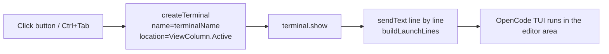

# OpenCode Dock

[English](README.md) | [简体中文](README_CN.md)

This is a very simple extension that does exactly one thing: it unconditionally puts a clickable icon in the VS Code status bar at the bottom right. Click it and an [OpenCode](https://opencode.ai) TUI launches in the active main window.

When it starts, it automatically inherits the user terminal environment configured in VS Code. For example, if the current repository is a Python project and a Conda environment is selected, OpenCode inherits that Conda environment, so the model working inside OpenCode can correctly invoke a terminal that has the right environment.

It also automatically names that terminal `OpenCode` (the title text is customizable), avoiding an extremely long and space-hogging tab.

The extension also ships a default `Ctrl+Tab` keybinding for instant launching, which behaves the same as pressing the button.

## Contents

- [Features](#features)
- [Getting Started](#getting-started)
  - [Prerequisites](#prerequisites)
  - [Install from the VS Code Marketplace](#install-from-the-vs-code-marketplace)
  - [Download a Release from GitHub](#download-a-release-from-github)
  - [Install from source](#install-from-source)
  - [Usage](#usage)
  - [Configuration](#configuration)
  - [Keybindings](#keybindings)
  - [Localization](#localization)
- [Notes](#notes)
- [How It Works & Development Notes](#how-it-works--development-notes)
- [License & Author](#license--author)

## Features

- **One-click launch**: Click the `OpenCode` button on the right side of the status bar, or press the default `Ctrl+Tab` keybinding, to quickly launch an OpenCode TUI. Either way can be made optional or customized.
- **Editor-area tab**: The terminal opens as a tab in the main window (rather than auto-splitting or opening into the terminal window), so the window is larger.
- **Consistent with opening a terminal manually**: It reuses the VS Code default terminal profile and inherits the environment, which is very useful in cases like Conda environments — OpenCode automatically uses the correct terminal environment without any extra OpenCode extension support.
- **Pre-launch environment setup**: You can configure multiple lines of commands to be executed one by one before OpenCode launches, which suits scenarios such as `cd`, `export`, and `source`. This is configurable per project folder (in the extension settings, choose to configure it for the project rather than for the user/global).
- **Configurable and stable title**: Avoids an extremely long and space-hogging tab.
- **Localized UI**: Command titles, setting descriptions, and hover tooltips follow the VS Code display language. English (the default, and the fallback for every other language) and Simplified Chinese are shipped.

## Getting Started

### Prerequisites

- VS Code `^1.106.0`: the minimum VS Code version must be greater than this version number.
- [OpenCode CLI](https://opencode.ai) installed separately. On any conventional OS with npm configured, you can install it with `npm install -g @opencode/cli`.

### Install from the VS Code Marketplace

Visit [NGC13009.OpenCodeDock - VS Code Marketplace](https://marketplace.visualstudio.com/items?itemName=NGC13009.opencode-dock) to view it.

### Download the Release File from GitHub

Visit the [OpenCodeDock - GitHub release](https://github.com/NGC13009/OpenCode-Dock/releases) page to get it.

### Install from source

```bash
git clone https://github.com/NGC13009/OpenCode-Dock.git
cd OpenCode-Dock/
npm install       # fetch the required dependencies
npm run compile   # compile Node
npm test          # run automated tests, optional

# package into the VSIX extension file required by VS Code
npm run package

# or, pack it with vsce better
vsce package

# In VS Code, right-click the VSIX file and choose to install it as a local extension, or run:
code --install-extension ./release/<*.vsix>
```

### Usage

Click the `🚀 OpenCode` button on the right side of the status bar, or press `Ctrl+Tab`, and a terminal opens in the editor area with the OpenCode TUI running in it. If you have not changed any extension configuration, this OpenCode TUI inherits the default terminal and environment variables you started in VS Code (for example, a VS Code project folder with a Conda environment and a Python interpreter already selected).

### Configuration

| Setting | Type | Default | Description |
| --- | --- | --- | --- |
| `opencodeDock.command` | string | `opencode` | The command used to launch OpenCode, such as `opencode`, `bunx opencode`, `npx @sst/opencode`, or an absolute path to an executable |
| `opencodeDock.preCommand` | string | `""` | Commands executed in order before launching OpenCode, one per line; blank lines are ignored (edited as multiline text in settings) |
| `opencodeDock.terminalName` | string | `OpenCode` | The terminal tab title; if left empty it falls back to `OpenCode`, and changes only affect terminals created afterwards |

Example:

```json
{
  "opencodeDock.command": "opencode",
  "opencodeDock.preCommand": "cd D:/work/my-project\nexport OPENCODE_MODEL=anthropic/claude-sonnet-4-5\nsource ./.env",
  "opencodeDock.terminalName": "OpenCode"
}
```

### Keybindings

- Defaults to `Ctrl+Tab`, equivalent to clicking the button (both trigger the same command, `opencodeDock.launch`).
- To rebind or remove it: press `Ctrl+K Ctrl+S` and search for "OpenCode Dock" or the command `opencodeDock.launch`, or edit `keybindings.json` directly.

Note: keybindings contributed by extensions take precedence over VS Code built-in ones, and `Ctrl+Tab` by default overrides the built-in "most recently used editor" switching. To restore it, just delete the keybinding as described above. The VS Code extension API does not support registering keybindings at runtime, so the keybinding cannot be exposed as a setting.

### Localization

Everything this extension displays follows the VS Code display language. There is no separate language setting to configure.

| Where | What is localized |
| --- | --- |
| Command Palette | The contributed command title "Launch OpenCode Dock" and its "OpenCode" category |
| Settings UI and `settings.json` hover | The descriptions of `opencodeDock.command`, `opencodeDock.preCommand`, and `opencodeDock.terminalName` |
| Status bar hover | The tooltip on the `🚀 OpenCode` button |
| Documentation | `README.md` (English) and `README_CN.md` (Simplified Chinese); switch with the link at the top of either file |

- Languages shipped: **English** (the default, and the fallback for any language that is not shipped) and **简体中文**.
- To change the language, run **Configure Display Language** from the Command Palette.
- To add a language, copy the two English files — `package.nls.json` to `package.nls.<locale>.json`, and `l10n/bundle.l10n.json` to `l10n/bundle.l10n.<locale>.json` — and translate the values. `npm test` verifies that the key sets stay identical across languages and that no Chinese text leaks into the English default files.

## Notes

- The extension creates a new terminal on every trigger; it does not reuse or automatically close old terminals. Close them manually when you no longer need them. (This is intentional by design, because I like launching multiple OpenCode windows at once. Even though the OpenCode v2 TUI already has its own tabs, I still prefer VS Code's tab management — it naturally supports splitting, popping a tab out into a separate window, or throwing it into the bottom terminal panel.)
- `Ctrl+Tab` is the default keybinding contributed by the extension and overrides VS Code's built-in "most recently used editor" switching; rebind it as needed.
- `preCommand` is executed line by line by the default shell, so these are real shell commands (PowerShell, bash, etc.); it is recommended to `cd` to the target directory first or use absolute paths. Generally speaking, whichever default terminal you configured in VS Code is the one that gets used. So make sure that terminal itself can run an OpenCode TUI (that is, OpenCode is installed in that terminal and is a program that can be launched as a global environment variable).
- `opencodeDock.terminalName` is only read when a terminal is created; terminals already open are not retroactively renamed after you change it.
- The icon uses the VS Code built-in codicon `$(rocket)` (it looks like a little rocket 🚀, visible on both the status bar button and the terminal tab). This requires VS Code 1.96+.

> I originally wanted to put the launch button where VS Code's own Copilot button lives — the one in the window title bar, to the right of the search box. But VS Code extensions cannot add custom buttons to the window title bar, because the official VS Code extension API does not support it (the Copilot title bar button is hardcoded into VS Code core), and there is no extension point for "run a command when the activity bar icon is clicked". So the next best thing was to use the officially supported position on the right side of the status bar.
>
> If you want a top button, you could use an `editor/title` menu contribution instead, but that would make this extension look like it sits in the same place as the official OpenCode VS Code extension. The problem: if no tab is open, the button is invisible.

## How It Works & Development Notes

After you click the button or press the keybinding, the extension triggers the `opencodeDock.launch` command:



> The Microsoft VS Code extension page does not currently render Mermaid diagrams correctly. If you find that the diagram does not render, or appears as source code, you can view the illustrated version of these notes on [this project's GitHub page](https://github.com/NGC13009/OpenCode-Dock.git).

- **Editor tab**: `createTerminal` uses `ViewColumn.Active` for `location`, so the terminal appears as a tab in the editor area; if that field is not set, VS Code places it in the bottom terminal panel by default.
- **Reusing the default terminal environment**: `shellPath`/`cwd` are not passed, so the behavior matches the user manually clicking "+" to create a new terminal.
- **Controllable tab name**: `name` comes from `opencodeDock.terminalName` (via `resolveTerminalName`, which trims whitespace and falls back to `OpenCode` when empty). The OpenCode TUI rewrites the terminal title through OSC sequences, so the extension injects `OPENCODE_DISABLE_TERMINAL_TITLE=1` into `env` to disable that and keep the tab name from being overwritten by the TUI.
- **Command assembly**: `buildLaunchLines` (`src/launchPlan.ts`) is a pure function: it splits `preCommand` by line, trims leading and trailing whitespace, ignores blank lines, and finally appends the launch command. It is decoupled from the VS Code API, so it can be unit tested without a GUI environment.
- **Always a new terminal**: Every trigger creates a new terminal and does not reuse old ones, so the behavior is predictable.
- **Localization**: user-visible text is either a `%key%` placeholder in `package.json` (resolved from `package.nls.json` / `package.nls.zh-cn.json`) or a `vscode.l10n.t()` call (resolved from `l10n/bundle.l10n.<locale>.json`). The English source strings are the keys, so a string without a translation degrades to English rather than showing a raw key.

All in all, the source code of this extension is really quite simple... because there was not much to do in the first place.

Tech stack: TypeScript + VS Code Extension API; tests use the Node built-in test runner.

Directory structure: the core content is just the following.

```text
./
├── src/
│   ├── extension.ts       # Activation: registers the command, status bar button, terminal
│   └── launchPlan.ts      # Launch command assembly + terminal title fallback (pure functions)
├── test/                  # Unit tests (launch plan + i18n consistency)
├── l10n/                  # Runtime strings: bundle.l10n.json, bundle.l10n.zh-cn.json
├── package.nls.json       # English (default) text for package.json contributions
├── package.nls.zh-cn.json # Simplified Chinese text for package.json contributions
├── scripts/
│   └── package.mjs        # vsce packaging (universal VSIX)
├── out/                   # tsc compile output (build artifact)
└── release/               # Packaged VSIX output (build artifact)
```

If you would like to contribute:

- Keep the functions in `launchPlan.ts` side-effect-free pure functions;
- New logic should come with corresponding unit tests;
- Any new user-visible string must be added to all four localization files (English and Simplified Chinese, for both `package.json` contributions and runtime text) — `npm test` will fail otherwise.

## License & Author

[GPLv3](LICENSE.txt)

[NGC13009](https://github.com/NGC13009)
